<p align="left">
  <picture>
    <source media="(prefers-color-scheme: dark)" srcset="docs/assets/brand/ferric-logo-dark.svg">
    
  </picture>
</p>

# FERRIC

**F**ID-to-structure **E**ngine for **R**elaxation, **R**esonance assignment, **I**ntegration & **C**hemometrics — an open-source Rust + WebGPU workbench for automated protein NMR resonance assignment, spin dynamics, analytical 1D/qNMR, DOSY diffusion, untargeted metabolomics, 2D chemical depiction, and sandboxed AI copilot workflows.

[](THIRD_PARTY.md)
[](docs/specs/00-architecture.md)
[](https://debsahu.github.io/ferric/)
[](https://debsahu.github.io/ferric/demo/)
[](https://debsahu.github.io/ferric/tours/)

**FERRIC** (`ferric` CLI + `ferric-gui` desktop/WebAssembly workbench) processes raw time-domain FIDs (Bruker `ser`/`fid` + custom `pulprog`, Varian/Agilent, JEOL Delta, JCAMP-DX) and frequency-domain spectra (Bruker `pdata`, NMRPipe, Sparky `.ucsf`) end-to-end in pure clean-room Rust (`f64` reference algorithms) and cross-vendor WebGPU (`wgpu` WGSL compute & contour shaders).

> **Human-in-the-Loop Development & Acknowledgements:** FERRIC is developed with a human NMR scientist ([`@debsahu`](https://github.com/debsahu)) in the loop throughout the entire process—owning the scientific specifications, spin-physics and scoring rules, benchmark validation, and release governance. Development was supported by compute credits generously given by Google under [**Google Gemini for Science**](https://ai.google/gemini-for-science/), and [`@debsahu`](https://github.com/debsahu)'s personal Claude ([Anthropic](https://www.anthropic.com/)) was used for independent code and scientific review.

## Deterministic Scientific Showcase

Every panel below is generated deterministically (`seed = 42`, zero external plotting libraries) directly from `nmr-core` forward models and solvers via `ferric export-fig --out-dir docs/assets`:

| Macromolecular Assignment & 3D Walk | Dynamics, 1D/qNMR, DOSY, Metabolomics, Exchange & Small Molecules |
| :---: | :---: |
| <br>**1. 2D `1H-15N` HSQC Contours & `evo-graph` Roots** — Positive/aliased-negative marching-squares contours, F1/F2 skylines, and assigned Ubiquitin spin systems. | <br>**2. 3D `HNCACB` Sequential Strip Walk (`Phe4 -> Gly10`)** — Intra-residue `i` and sequential `i-1` `CA`/`CB` slices with `Thr7` `CB > CA` phase inversion and `Gly10` `CB` null. |
| <br>**3. `1UBQ` Lipari–Szabo `S^2` Putty & NOEs** — Dual-field `M1–M5` Model-Free order-parameter ribbon (`Gly76` flexible tail + `Ile23` `R_ex`) and long-range NOE restraints *(synthetic showcase)*. | <br>**4. Analytical 1D `J`-Tree, Kinetics Stack & `qNMR`** — Recursive Hoye `ddd` splitting tree, 5-timepoint arrayed stack, and GUM internal-standard purity *(synthetic showcase)*. |
| <br>**5. Pseudo-2D `DOSY` Diffusion Map (`BPP-LED`)** — Discrete `K = 1..2` Stejskal–Tanner `BIC` mixture separation (`Maleate`, `Raffinose`, `Lysozyme`) and Stokes–Einstein `MW` *(synthetic showcase)*. | <br>**6. 1D Metabolomics (`PCA`, `OPLS-DA` & `STOCSY`)** — Adaptive intelligent bucketing, `95%` Hotelling `T^2` ellipse, Wiklund S-plot, and `L-Lactate` driver trace *(synthetic showcase)*. |
| <br>**7. Chemical Exchange (`CEST`, `CPMG` & `CSP` `Kd`)** — Higham `[6/6]` Padé 2-state `CEST` dip, dual-field Baldwin `CPMG` dispersion, and quadratic tight-binding `Kd` *(synthetic showcase)*. | <br>**8. `Octet` 2D Skeletal Depiction & `1H`/`13C` Link** — ACS-styled `(S)`-Ibuprofen depiction with CIP stereochemical perception and HOSE/additivity `1H`/`13C` shift table. |

## 30-Second Quickstart

Requires a stable Rust toolchain (`rustup`, Rust 1.80+) and a Vulkan, Metal, or DX12 GPU (falls back cleanly to multi-threaded `rayon` CPU `f64` everywhere).

### 1. Interactive Desktop Workbench (`ferric-gui`)

Download pre-built desktop + CLI archives (`macos-arm64` `.dmg`/`FERRIC.app`/`.tar.gz`, `windows-x86_64` `.zip`, `linux-x86_64` `.tar.gz`) from [**GitHub Releases**](https://github.com/debsahu/ferric/releases), or build from source:

```bash
cargo run --release -p nmr-gui --bin ferric-gui
```

Drag and drop any Bruker experiment directory (`ser`/`fid` or `pdata/1`), NMRPipe file, `.ucsf` spectrum, `.jdx`, NMR-STAR `.str`, or NMR Exchange Format (`.nef`) project onto the canvas—or launch the mobile/tablet-responsive, zero-install [**Live WebGPU Browser Demo**](https://debsahu.github.io/ferric/demo/) (local build: `bash scripts/build_web_demo.sh`).

### 2. Automated Command-Line Workflows (`ferric`)

*(The `nmrassign` compatibility alias from `v0.14.x` was removed in `v0.15.0`; use `ferric`.)*

```bash
# End-to-end raw-FID processing -> peak picking -> evo-graph assignment -> NEF v1.1 + HTML QC report
cargo run --release -p nmr-cli --bin ferric -- pipeline \
  --seq ubiquitin.fasta --fid-hsqc ./10_hsqc --fid-triple HNCACB=./20_hncacb \
  --fid-triple CBCACONH=./21_cbcaconh --out-dir ./ubq_out --engine auto

# Analytical 1D processing, multiplet J-tree extraction, pseudo-2D DOSY, and 1D metabolomics demos
cargo run --release -p nmr-cli --bin ferric -- nmr1d process --in ./1d_fid --out proc_1d.tsv --auto-phase
cargo run --release -p nmr-cli --bin ferric -- dosy fit --demo --criterion bic -o dosy_fit.json
cargo run --release -p nmr-cli --bin ferric -- metabolomics oplsda --demo -o metab_study.json

# Deterministically regenerate all 8 publication SVG figures in docs/assets/
cargo run --release -p nmr-cli --bin ferric -- export-fig --out-dir docs/assets --panel all
```

### 3. AI Assistant Copilot (`MCP` JSON-RPC 2.0 Server)

Expose 12 workspace-sandboxed core MCP tools (`inspect_nmr_directory`, `read_nmrstar_summary`, `read_peak_list_summary`, `evaluate_dataset_qc`, `predict_homolog_free_torsions` under `<= 25%` sequence-identity firewall, `fit_relaxation_or_exchange`, `track_csp_titration`, `analyze_nmr1d_spectrum`, `fit_dosy_diffusion`, `run_metabolomics_chemometrics`, plus `--mode read-write` `write_curated_peak_tsv` / `export_nmrstar_shifts`), 5 guided spectroscopist prompts, and live `ferric-gui` loopback bridge tools (`256`-step undo + viewport PNG capture) to AI research clients:

```bash
# Emit ready-to-paste client configuration JSON (antigravity, claude-desktop, cursor, generic)
ferric mcp-config --client antigravity --root ./ubq_out --mode read-only

# Launch sandboxed stdio MCP server directly (default --mode read-only forbids disk writes)
ferric mcp --transport stdio --root ./ubq_out --mode read-only
```

## Benchmark & Scientific Validation Summary

All macromolecular assignment solvers (`evo-graph` default, `standard` parallel-tempering SA, and opt-in `bayes-sa` Joint Bayesian Factor-Graph RJ-MCMC) are regression-gated across 5 deterministic seeds (`0..4`; `HC-Prec` = precision among assignments with calibrated confidence `>= 0.80`):

| Dataset & Regime | `evo-graph` (`CPU f64`) | `standard` (`CPU f64`) | `standard` (`WebGPU f32`) | `bayes-sa` (`CPU f64` / `WebGPU f32`, opt-in) |
| :--- | :--- | :--- | :--- | :--- |
| **Ubiquitin `--realistic`** (`5`-exp Bruker physics, `5` seeds) | **98.4% acc** / 90.8% rec<br>**98.4%** (`310/315`) HC-prec | **90.0% acc** / 72.5% rec<br>**97.1%** (`170/175`) HC-prec | **88.4% acc** / 70.2% rec<br>**95.8%** (`181/189`) HC-prec | **97.1% / 96.7% acc**, 86.1% / 85.3% rec<br>**99.3%** (`268/270`) / **99.2%** (`263/265`) HC-prec |
| **`CISD3` (`BMRB 51439`)** (`900 MHz` raw Bruker, missing `HNCACB`, dev target, `5` seeds) | **64.38% acc** / 40.39% rec<br>**100.00%** (`59/59`) HC-prec | **62.50% acc** / 39.22% rec<br>**92.86%** (`52/56`) HC-prec | **58.75% acc** / 36.86% rec<br>**96.61%** (`57/59`) HC-prec | **65.25% / 78.07% acc**, 40.94% / 47.06% rec<br>**86.25%** (`69/80`) / **100.00%** (`60/60`) HC-prec |
| **Heldout `N=9` Real BMRB Raw-FID Cohort** (`5` seeds, `evo-graph`) | **79.1% macro** / **80.0% micro** (`2327/2907`) acc, **71.6%** macro rec, **95.6% macro** / **94.7% micro** (`1442/1522`) HC-prec | — | — | — |
| **Unseen Cold BMRB Cohorts** (`cold_p12` `7/7`, `cold_p13` `5/7`, `seen_p13_w2` `5/7`) | `66.88%` macro-acc on `seen_p13_w2`; unseen cold micro HC-prec **88.25%–95.30%** | `63.28%` macro-acc on `seen_p13_w2`; unseen cold micro HC-prec **89.14%–94.14%** | `61.63%` macro-acc on `seen_p13_w2`; unseen cold micro HC-prec **88.58%–96.31%** | `79.08% / 80.56%` macro-acc on `seen_p13_w2`; unseen cold micro HC-prec **86.18% / 88.03%** |

### Scientific Scope & Calibration Candor

- **Backbone Confidence Calibration & Spent Cold Cohorts (`data/benchmark/real_manifest.tsv`, 40 BMRB entries)**: Isotonic/hierarchical confidence maps achieve `94.07%–95.62%` out-of-fold micro HC-precision (`pooled_ECE_10 = 0.0222–0.0369`) on the `26`-protein non-cold LOPO pool *(in-sample with respect to `min_bidir_aliphatic_frac` feature selection)*. Across three pre-registered single-shot unseen cold cohorts—the latest `cold_p13_w2` (`5/7` runnable raw-FID entries, relabeled **`seen_p13_w2`** in `real_manifest.tsv` immediately after unblinding so spent cohorts are never reused as unseen claims; `2` entries remain newly sealed)—empirical micro HC-precision at `confidence >= 0.80` spans **`86.18%–96.31%`**, so `>= 0.80` confidence should be interpreted as an empirical `~86%–96%` range rather than a guaranteed `>= 94%` floor on arbitrary unseen proteins.
- **Torsion Angles & Residual Dipolar Couplings**: `ferric torsions` (`200`-entry BMRB/PDB database under `<= 25%` sequence-identity / `TM < 0.50` `HomologFirewall`) reaches `70.0%` `Good` (`541/773`) and `phi/psi` `CircMAE = 13.79°` (`3.70%` wrong basin; in-sample wrt hyperparameter tuning). On the cold single-medium RDC target `1KHM -> 1ZZK`, adding RDCs improves NOE-only backbone RMSD on `5/5` seeds (`1.862–4.141 Å` CPU / `2.390–3.988 Å` WebGPU `lowE`), but the pre-registered single-shot holdout does **not** reach development-target accuracy (`0/5` seeds `< 1.80 Å`; `ByPeptidePlane Q_free < 0.55` on `3/5` CPU / `2/5` WebGPU seeds; `F8`).
- **Synthetic Forward-Model, Blind Empirical Scorecard, Protocol & Browser Validation Status (Phases 13–17)**: Spin relaxation & chemical exchange (`R1`/`R2`/hetNOE, Lipari–Szabo `S^2`, `CEST`/`DEST`, `CPMG`/`R1rho`, `CSP` `Kd`), analytical 1D (`Voigt` deconvolution, Hoye `J`-trees, `qNMR`), pseudo-2D `DOSY`, and 1D `Metabolomics` (`AIB`, `PQN`, `PCA`, `OPLS-DA`, `STOCSY`) modules are validated strictly on **synthetic forward-model self-consistency benchmarks** and make **no real-data accuracy claims**: across all `8` pre-registered Phase 17 blind single-shot empirical gates (`data/benchmark/p17_empirical_preregistration.json`, frozen `crates/` `02c6246a3cb2` & pre-download `bbc770a` adapters), the standing tally is **`0 PASS`, `5 FAIL` (`F10`, `F11`, `F14`, `F16`, `F17`), and `3 NOT_EVALUABLE` (`F13a`, `F13b`, `F13c`)**, with uncovered vendor/convention/scaling gaps tracked in `F28`–`F29`. `MCP` copilot (`F18`) and `wasm32` WebGPU browser compatibility (`F21`) are verified via automated protocol/headless tests plus single-host Apple Silicon smoke runs (`stdio`/loopback HTTP & headless `Chrome 157` `Metal`), while live multi-IDE (`Antigravity`/`Claude Desktop`/`Cursor` GUI), `D3D12`/`Vulkan`, `Safari`/`Firefox`, and physical mobile-device sessions remain `[ ]` open in [`TODO.md`](TODO.md) (`F10`, `F11`, `F13`, `F14`, `F16`–`F18`, `F21`, `F24`–`F29`).

## Documentation, Specifications & Live Demo

- **User Manual ([Hosted Site](https://debsahu.github.io/ferric/) · `docs/manual/`)**: [Overview](docs/manual/index.md) · [01 Quickstart & Workflows](docs/manual/01-quickstart-and-workflows.md) · [02 Custom `pulprog` & DSP](docs/manual/02-custom-pulprog-and-dsp.md) · [03 Solvers & Calibration](docs/manual/03-solvers-and-calibration.md) · [04 Dynamics & Exchange](docs/manual/04-dynamics-and-exchange.md) · [05 1D Multiplets, `qNMR` & `DOSY`](docs/manual/05-nmr1d-multiplets-and-dosy.md) · [06 `MCP` & CLI Reference](docs/manual/06-mcp-and-cli-reference.md) · [07 Clean-Room Provenance](docs/manual/07-clean-room-provenance.md) · [08 Metabolomics & Chemometrics](docs/manual/08-metabolomics-and-chemometrics.md) · [09 AlphaFold & Integrative NMR](docs/manual/09-alphafold-and-integrative-nmr.md) · [10 References & Acknowledgments](docs/manual/10-references-and-acknowledgments.md)
- **Technical Specifications, References & Live Demo**: [Crossref-Verified Bibliography (`REFERENCES.md`)](REFERENCES.md) · [Architecture & Specs (`docs/specs/`)](docs/specs/) · [**Interactive Video Tours**](https://debsahu.github.io/ferric/tours/) · [**Live WebGPU Browser Demo**](https://debsahu.github.io/ferric/demo/) ([source](docs/demo/)) · [Dataset Provenance (`data/benchmark/PROVENANCE.md`)](data/benchmark/PROVENANCE.md) · [Roadmap & Open Validation Gates (`TODO.md`)](TODO.md)

## Clean-Room Provenance & Licence

FERRIC is a strict clean-room implementation derived exclusively from peer-reviewed literature and public standards (NMR-STAR v3, NEF v1.1, JCAMP-DX), with zero code, parameters, or macros from proprietary, academic-only, GPL, or AGPL NMR packages.

Released under the **MIT Licence**, incorporating embedded `Octet-Draw` 2D chemical structure & analytical crates under **Apache-2.0** and public-domain (**CC0**) BMRB / wwPDB reference statistics and fixtures. Full dependency and data attribution is audited in [`THIRD_PARTY.md`](THIRD_PARTY.md) and [`data/benchmark/PROVENANCE.md`](data/benchmark/PROVENANCE.md).
