# Chapter 1: Quickstart & Multi-Regime NMR Workflows

`nmr-assign` is designed around **zero-friction ingest** and **problem-regime specialization**. Rather than forcing globular triple-resonance assumptions onto intrinsically disordered proteins, supramolecular methyl-labeled complexes, paramagnetic metalloproteins, or small-molecule mixtures, the workspace classifier (`nmr-core::classify`) inspects acquisition headers and executed pulse programs in under `50 ms` to configure the right processing, peak-picking, and solver pipeline automatically.

---

## 60-Second End-to-End Quickstart

### 1. Inspect Any Spectrometer Folder or Archive

Point `nmrassign inspect` at a parent directory (or `.tar` / `.tar.gz` / `.tgz` / `.zip` archive) containing raw Bruker experiment numbers or Varian `.fid` directories:

```bash
# Scan headers and executed pulse programs in < 50 ms without reading bulk FID bytes
nmrassign inspect ./workspace/ubiquitin_study
nmrassign inspect ./workspace/ubiquitin_study --json > inventory.json
```

`inspect` reports each experiment's vendor, dimensionality (`1D`, `2D`, `3D`, `Pseudo3D`, `4D`), raw-FID vs processed state, quadrature mode, NUS sparsity (`nuslist` / `sampling.sch`), classified experiment type (`15N-HSQC`, `HNCACB`, `CBCACONH`, `HNCO`, `CON`, `13C-HMQC`, `R1`, `CEST`, `CPMG`, `DOSY`), and recommended problem regime.

### 2. One-Command Headless Pipeline (`nmrassign pipeline`)

Run raw FID processing (including `IST`/`FISTA` NUS reconstruction and empirical `{sign, fold}` `2D HSQC` registration), two-pass `StripBank3D` corroborated peak picking, backbone assignment, `DatasetQcReport` calibration, lossless `NEF v1.1` export, and self-contained `HTML+SVG` quality reporting in one command:

```bash
nmrassign pipeline \
  --seq ./workspace/ubiquitin.fasta \
  --fid-hsqc ./workspace/ubiquitin_study/2 \
  --fid-triple HNCACB=./workspace/ubiquitin_study/3 \
  --fid-triple CBCACONH=./workspace/ubiquitin_study/4 \
  --fid-triple HNCO=./workspace/ubiquitin_study/10 \
  --fid-triple HNCACO=./workspace/ubiquitin_study/11 \
  --solver evo-graph \
  --out-dir ./workspace/ubq_results
```

Output artifacts written to `./workspace/ubq_results`:
- `shifts.str` — `NMR-STAR v3.2` chemical shifts in the experimental spectrum's ppm frame, annotated with per-residue calibrated confidences.
- `result.nef` — Lossless `NEF v1.1` project file storing sequence, peaks, resonance lists, user locks, and `ProcessingRecipe` metadata.
- `peaks.tsv` — 7-column picked peak table (`experiment`, `H`, `N`, `C`, `sign`, `height`, `volume`).
- `processing_recipe.json` — Exact deterministic record of window functions, group delays, phases, NUS settings, and any `AxisRescueAuditRecord` diagnostics.
- `report.html` — Standalone single-file quality report with Chemical Shift Index (`CSI`) secondary shifts, strip-walk ladders, reliability summary, and optional Ramachandran / `RDC` / IDP propensity tracks.

### 3. Drag-and-Drop Interactive Desktop & Browser Workbench

Launch `nmr-gui` (`cargo run --release -p nmr-gui`) and drag a spectrometer folder, `.tar.gz` archive, `.fasta` sequence, or `.nef` session onto the window:

1. **Experiment Selection Matrix (`nmr-gui::ingest_panel`)**: Displays every discovered dataset with auto-detected experiment role, observed nuclei (`1H`, `15N`, `13C`, `19F`, `31P`), field strength (`MHz`), quadrature/NUS badge, editable role dropdowns, include/exclude checkboxes, and a 1-click **Process, Pick & Run** button.
2. **6-Stage *"What Next?"* Workflow Stepper (`nmr-gui::workflow_bar`)**: Tracks readiness across **1. Ingest → 2. Process FIDs → 3. Pick Peaks → 4. Assign Spins → 5. Fold / Dynamics → 6. Export & Report**, highlighting missing inputs or `DatasetQcReport` warnings alongside a single contextual action button.
3. **Fuzzy Command Palette & Two-Key Chords**: Press **`Cmd/Ctrl+K`** to fuzzy-search every workbench operation, or use fast two-letter spectrum chords (`vt`, `ct`, `cb`, `pa`, `pd`, `pc`, `st`, `at`, `oz`, `Space`, `?` — full table in [Chapter 6](06-mcp-and-cli-reference.md#interactive-workbench-keyboard-shortcuts)). Every edit is recorded on a `256`-step Undo/Redo ring buffer (**`Cmd/Ctrl+Z`**).
4. **Zero-I/O Built-in Multi-Modal Demo Suite (`🚀 Load Built-in Demo Suite`)**: On both native desktop and `wasm32-unknown-unknown` browser builds (`nmr_gui::demo_preset`), clicking **`🚀 Load Built-in Demo Suite`** in the top toolbar populates synthetic Ubiquitin `2D HSQC` + `3D HNCACB`/`HNCO` strips + `1UBQ` 3D coordinates + 4-mode 1D multiplet stack + `DOSY` decay series + 24-sample 2-group `Metabolomics` cohort purely in memory with zero filesystem I/O.

---

## Protein Workflow 1: Standard Folded Globular Proteins (`5–30 kDa`)

### Recommended Experiment Set

| Role | Canonical Experiments | Key Physics Used by `nmr-assign` |
| :--- | :--- | :--- |
| **2D Amide Root** | `2D 1H-15N HSQC` (or `TROSY-HSQC`) | Defines backbone `(H, N)` root coordinates; filters `Asn`/`Gln` `NH2` sidechain doublets and `t1` sinc ridges |
| **`CA` / `CB` Walk** | `3D HNCACB` (`CA > 0`, `CB < 0`) + `3D CBCA(CO)NH` (`i-1` only) | Primary sequential connectivity & `Gly`/`Ala`/`Ser`/`Thr` amino-acid typing; intensity-aware `1J`/`2J` `i` vs `i-1` disambiguation when `CBCA(CO)NH` is absent |
| **`C'` Carbonyl Walk** | `3D HNCO` (`i-1`) + `3D HN(CA)CO` (`i, i-1`) | Resolves degenerate aliphatic links (`sigma_C` high dispersion) and flags pre-Proline upfield `C'` shifts |
| **Sparse Fallback** | `3D HNCA` + `3D HN(CO)CA` | Supported cleanly when `CB` transfer is sensitivity-limited; `DatasetQcReport` monitors bidirectional aliphatic corroboration |
| **Aliphatic & Aromatic Sidechains** | `13C-HSQC`, `3D HCCH-TOCSY`, `CC(CO)NH`, `H(CC)(CO)NH`, `2D (HB)CB(CGCD)HD/HE`, `His 15N-HMQC` | Completes `CHn` rotamers, `Phe`/`Tyr`/`Trp`/`His` rings, and `His` protonation/tautomer states |


*Figure 1.1: Deterministic `nmrassign export-fig --panel hsqc` output showing positive and aliased-negative 2D `1H-15N` HSQC marching-squares contours, 1D F1/F2 skyline projections, and `evo-graph` assigned Ubiquitin spin-system roots (`seed = 42`).*


*Figure 1.2: Deterministic `nmrassign export-fig --panel strips` 3D `HNCACB` sequential strip walk across Ubiquitin `Phe4 -> Gly10`, illustrating intra-residue `i` and sequential `i-1` `CA`/`CB` ladders, `Thr7` `CB > CA` phase inversion, and `Gly10` `CB` absence (`seed = 42`).*

### Step-by-Step Globular CLI Workflow

```bash
# 1. Pick 2D + 3D spectra (automatically runs Pass-2 StripBank3D weak-peak rescue)
nmrassign pick \
  --fid-hsqc ./data/ubq/2 \
  --fid-triple HNCACB=./data/ubq/3 \
  --fid-triple CBCACONH=./data/ubq/4 \
  --fid-triple HNCO=./data/ubq/10 \
  --fid-triple HNCACO=./data/ubq/11 \
  --method classical \
  --out ./out/ubq_peaks.tsv

# 2. Run backbone resonance assignment (unlabelled reference offset alignment enabled by default)
nmrassign assign \
  --peaks ./out/ubq_peaks.tsv \
  --seq ./data/ubq/ubiquitin.fasta \
  --solver evo-graph \
  --nef-out ./out/ubq_backbone.nef \
  --report-out ./out/ubq_backbone_report.html \
  --out ./out/ubq_backbone

# 3. Extend to aliphatic, aromatic (--ph), and Bayesian stereospecific prochiral sidechains
nmrassign sidechain \
  --star ./out/ubq_backbone.str \
  --peaks ./out/ubq_sidechain_peaks.tsv \
  --aromatic --ph 6.5 \
  --his-hmqc ./data/ubq/his_hmqc.ft2 \
  --hbcbgcdhd ./data/ubq/hbcbcgcdhd.ft2 \
  --hbcbgcdce ./data/ubq/hbcbcgcdcehe.ft2 \
  --stereospec \
  --j-couplings ./data/ubq/3j_couplings.tsv \
  --intra-noes ./data/ubq/local_noes.tsv \
  --out ./out/ubq_all_atom.str

# 4. Predict post-assignment torsions (4-layer HomologFirewall) & fold 3D ensemble with NOEs + RDCs
nmrassign torsions \
  --shifts ./out/ubq_all_atom.str \
  -o ./out/ubq_torsions.tsv

nmrassign structure \
  --star ./out/ubq_all_atom.str \
  --noesy-peaks ./data/ubq/noesy_3d.tsv \
  --rdc ./data/ubq/bicelle_rdcs.tsv \
  --torsion-db \
  --rdc-free-frac 0.20 \
  --conformers 20 \
  --engine auto \
  --out-pdb ./out/ubq_ensemble.pdb
```

> [!NOTE] Strict Sequence-Only & Stereospecific Safety Guarantees
> - **Backbone assignment is strictly sequence-only**: neither `torsion_db` nor 3D PDB coordinates are ever consulted during `nmrassign assign` unless a user explicitly invokes structure-based `methyl` or `paramagnetic` `PCS` fitting.
> - **Histidine tautomer & metal safety (`nmr-core::aromatic`)**: `His` tautomer states (`Nδ1-H`, `Nε2-H`, imidazolium) require at least one `15N` observation for `Resolved` status and abstain cleanly (`FastExchangeUncommitted` or `MetalCoordinatedCandidate`) under $\chi^2_{0.95}$ residual gates, preventing false tautomer calls on Zn-coordinated histidines.
> - **Stereospecific prochiral commitment (`nmr-core::stereospec`)**: `HB2`/`HB3`, `HG1`/`HG2`, and `HD1`/`HD2` receive `Ambiguity_code = 1` **only** when the Student-$t(\nu=4)$ `3J` + local-NOE + tempered Lovell rotamer posterior reaches $\ge 0.90$; dynamic surface sidechains default safely to `Ambiguity_code = 2`.
> - **`RDC` & 3D folding validation scope (`F8`)**: `Ubiquitin` (`1D3Z`/`1UBQ`) and `GB1` (`2JSV`/`1PGB`) served as development folding targets; on the cold experimental unseen target `1KHM` (`KH3` domain, `89 aa`, experimental NOEs + single-medium bicelle `RDC`s + firewalled `BMRB 4405` shifts evaluated against `0.95 Å` apo X-ray `1ZZK`), adding `RDC`s improves NOE-only backbone RMSD (`3.824–4.798 Å`) on `5/5` seeds to `1.862–4.141 Å` (`CPU`) / `2.390–3.988 Å` (`WebGPU` `lowE`) and improves `ByPeptidePlane` $Q_{\text{free}}$ on `4/5` seeds, while `< 1.80 Å` development-target accuracy is not reached on an unseen protein.

---

## Protein Workflow 2: Large / Perdeuterated Complexes & `13C`-Methyl TROSY (`30–100+ kDa`)

Above `~35 kDa`, rapid transverse relaxation broadens protonated backbone `HNCACB` pathways unless samples are perdeuterated (`2H, 15N, 13C`) and selectively protonated at methyl positions (`Ile-δ1`, `Leu-δ1/δ2`, `Val-γ1/γ2`, `Met-ε`, `Ala-β`, `Thr-γ2`; Tugarinov & Kay 2003). `nmr-assign` provides dedicated 2D/3D/4D methyl-TROSY peak picking (`nmr-core::methyl_trosy`) and a WebGPU multi-replica Metropolis–Hastings NOE contact-graph assignment solver (`nmr-core::methyl_solver`, `nmr-gpu::methyl_gpu`).

### Supported Precursor Labeling Schemes

- **`ILV-proS` / `ILV-proR`**: Stereospecific acetolactate labeling where each `Leu` or `Val` carries a single non-racemic methyl signal (Gans et al. 2010).
- **`ILV-racemic`**: Both geminal `Leu-δ1/δ2` and `Val-γ1/γ2` methyls labeled (paired automatically via `HMCM(CG)CBCA` or short-mixing intra-residue NOE cross-peaks).
- **`ILVMAT`**: Full six-residue methyl-TROSY suite (`Ile-δ1` `~11–15 ppm`, `Ala-β` `~16–22 ppm`, `Thr-γ2`, `Met-ε`, `Leu-δ`/`Val-γ` `~18–27 ppm`).
- **Custom residue:atom masks**: Comma-separated `ILE:CD1,MET:CE,ALA:CB` lists for tailored biosynthetic labeling.

### Running Structure-Based Methyl-TROSY Assignment

```bash
nmrassign methyl \
  --pdb ./data/maltose_bp/1ezp_apo.pdb \
  --hmqc ./data/maltose_bp/methyl_hmqc_2d.ft2 \
  --noesy ./data/maltose_bp/hmqc_noesy_3d.ft3 \
  --labeling ILV-proS \
  --hmcmcbca ./data/maltose_bp/hmcmcbca_geminal.tsv \
  --engine gpu \
  -o ./out/mbp_methyl_shifts.str
```

Key capabilities:
- **Exact Metropolis–Hastings independent multi-replica SA**: Matches observed 3D `C-C-H` or 4D `C-H-C-H` HMQC-NOESY cross-peaks against bidirectional $r_{\text{CC}}^{-6}$ methyl contact graphs derived from an X-ray, cryo-EM, or homology model (`CPU/WebGPU parity <= 3.45e-6`).
- **$C_K$ symmetry-orbit calibration**: Homo-oligomeric assemblies with symmetric subunits are normalized across symmetry orbits without double-counting intra- vs inter-protomer contacts.
- **TDR-safe GPU execution**: Long annealing stages chunk at `<= 4,096` proposals per submission so `370+ aa` complexes finish in `< 2 s` on WebGPU without triggering OS graphics watchdog resets.

---

## Protein Workflow 3: Proline-Rich IDPs (`13C`-Detected Protonless NMR)

Intrinsically disordered proteins (`IDPs`) and low-complexity domains suffer from severe `1H^N` chemical-shift collapse (`7.8–8.6 ppm`), rapid base-catalyzed amide proton exchange with bulk water at physiological pH (`pH 7.0–7.5`, `298–310 K`), and abundant **Proline** residues (`15–30%`) that lack amide protons altogether and shatter conventional `1H`-detected sequential walks into disconnected islands.

`nmr-assign` solves this directly with protonless `13C`-detected experiment models (`nmr-core::c13_detected`) and a continuous **through-Proline** CPU/WebGPU dipeptide solver (`nmr-core::idp_solver`, `nmr-gpu::idp_gpu`; Bermel et al. 2006–2009).

### Protonless `13C`-Detected Experiment Suite

| Experiment | Observed Correlation | Role in `--regime idp-13c` |
| :--- | :--- | :--- |
| **`2D CON`** | `(13C'(i-1), 15N(i))` | Primary peptide-bond root map (`15N` `105–142 ppm`), directly observing `-Xaa-Pro-` and `-Pro-Pro-` imino nitrogen roots (`132–142 ppm`) with IPAP `±1J(C',CA) ≈ 53.5 Hz` satellite suppression |
| **`2D CACO`** | `(13C'(i), 13CA(i))` | High-resolution intra-residue `CA–C'` anchor |
| **`3D CANCO`** | `(13C'(i-1), 15N(i), 13CA(i) & 13CA(i-1))` | Bidirectional sequential walk linking `CON(i)` to `CON(i-1)` and `CON(i+1)` cleanly across Prolines |
| **`3D CBCACON`** | `(13C'(i-1), 15N(i), 13CA(i-1), 13CB(i-1))` | Unambiguous `i-1` aliphatic typing |
| **`3D CCCON`** | `(13C'(i-1), 15N(i), 13C_aliph(i-1))` | Full sidechain carbon relay into `Pro` (`CD` `~49.5 ppm`, `CG` `~27.2 ppm`) and aliphatic residues |
| **`3D NCACO`** | `(13C'(i), 15N(i), 13CA(i))` | Intra-residue registration bridge with automatic unlabelled `NCACO` carrier-offset alignment |

### End-to-End `13C`-Detected IDP Commands

```bash
# 1. Assign unbroken backbone chains directly through Prolines using T/pH-adjusted ncIDP coil priors
nmrassign assign \
  --regime idp-13c \
  --seq ./data/alpha_synuclein.fasta \
  --con ./data/idp/con_2d.ft2 \
  --caco ./data/idp/caco_2d.ft2 \
  --canco ./data/idp/canco_3d.ft3 \
  --cbcacon ./data/idp/cbcacon_3d.ft3 \
  --cccon ./data/idp/cccon_3d.ft3 \
  --ncaco ./data/idp/ncaco_3d.ft3 \
  --temp-k 298.15 \
  --ph 7.4 \
  --engine gpu \
  --report-out ./out/idp_report.html \
  --out ./out/idp_assigned

# 2. Compute transient Secondary Structure Propensity (SSP) & 4-state (alpha, beta, PPII, coil) populations
nmrassign propensity \
  --shifts ./out/idp_assigned.str \
  --temp-k 298.15 \
  --ph 7.4 \
  --format tsv \
  -o ./out/idp_propensity.tsv
```

In `--regime idp-13c`, Proline is an active node in the `CON(i)` chain rather than a gap, scored against neighbor-, temperature- ($\partial\delta/\partial T$, Kjaergaard & Poulsen 2011), and pH-adjusted (Platzer et al. 2014) `ncIDP` random-coil distributions ($\sigma_{\text{CA}} \approx 0.45\text{ ppm}$; Tamiola, Acar & Mulder 2010) with look-elsewhere-penalized unlabelled offset registration.

---

## Protein Workflow 4: Paramagnetic Metalloproteins (`PCS` & `PRE` Blind Zones)

Iron-sulfur proteins (`[2Fe-2S]`, `[4Fe-4S]`), high-spin $3d$ transition-metal centers (`Co2+`, `Fe2+`, `Ni2+`, `Cu2+`), and lanthanide tags (`Yb3+`, `Tm3+`, `Tb3+`, `Dy3+`) introduce two coupled physical effects (`nmr-core::paramagnetic`):

1. **Solomon Dipolar Paramagnetic Relaxation Enhancement (`PRE`, $\Gamma_2 \propto r_{\text{M}}^{-6}$)**: Bleaches `1H`/`13CA` coherence within a metal-class-specific blind sphere (`r_bleach = 13.5 Å` isotropic broadeners, `9.0 Å` strong lanthanides, `8.5 Å` `[2Fe-2S]`/`[4Fe-4S]` & high-spin $3d$, `5.5 Å` moderate lanthanides like `Yb3+`), creating missing amides and `CA`-bleached `CB`-only strips near coordinating `Cys`/`His` motifs.
2. **Anisotropic Magnetic Susceptibility Pseudocontact Shifts (`PCS`, $\Delta\delta^{\text{PCS}} \propto r_{\text{M}}^{-3}$)**:

$$\Delta\delta^{\text{PCS}}(\mathbf{r}) = \frac{1}{12\pi r^3}\left[\Delta\chi_{\text{ax}}\frac{2z^2 - x^2 - y^2}{r^2} + \frac{3}{2}\Delta\chi_{\text{rh}}\frac{x^2 - y^2}{r^2}\right]$$

where $(x, y, z)$ are nuclear coordinates in the principal frame of the traceless $\Delta\chi$ tensor centered at metal position $\mathbf{r}_{\text{M}}$.

### Running Paramagnetic Backbone Assignment & $\Delta\chi$-Tensor Fitting

```bash
nmrassign assign \
  --regime paramagnetic \
  --peaks ./data/cisd3/picked_peaks.tsv \
  --seq ./data/cisd3/cisd3.fasta \
  --metal-ligands CYS55,CYS57,CYS83,HIS85 \
  --r-bleach 8.5 \
  --pdb ./data/cisd3/alphafold_backbone.pdb \
  --pcs ./data/cisd3/observed_pcs.tsv \
  --solver evo-graph \
  --out ./out/cisd3_paramagnetic
```

> [!IMPORTANT] Paramagnetic Modeling Guidance & Empirical Caveats
> - **Eliminating blind-zone false positives (`u_para`)**: Without paramagnetic blind-zone awareness, standard globular assignment forces noise or uncorroborated `CA`-less roots into sequence slots coordinated to the paramagnetic metal center. Enabling `--regime paramagnetic` activates `u_para` bleach-prior annealing and `>= 2`-slot corroborated rescue, eliminating blind-zone false positives (`0` blind-zone FPs on `CISD3` `[2Fe-2S]` and `1I7H` Ferredoxin). Note that when overall unassigned recall is prioritized over strict blind-zone abstention on `CA`-sparse datasets, generic `CA`-less handling on `standard` can yield slightly higher raw accuracy/recall (`64.24%` vs `60.61%` on `CISD3`) at the cost of admitting blind-zone false positives, whereas `evo-graph` improves both accuracy (`55.43% -> 62.26%`) and high-confidence precision (`100.00%`, `0` FPs).
> - **Outer-sphere `PCS` fitting & metal-coordinate bounds**: Near the metal center ($r_{\text{M}} < 10\text{–}11\text{ \AA}$), Fermi contact shifts, Curie-spin cross-correlated relaxation, and structural flexibility violate pure point-dipole `PCS` scaling. When fitting 5-parameter Schmitz/Otting SVD + Huber IRLS or 8-parameter `VarPro` (`fit_pcs_tensor_svd` / `refine_metal_position_and_tensor`), keep the canonical metal-displacement bound $|\Delta\mathbf{r}_{\text{M}}| \le 1.5\text{ \AA}$ and `fit_offset = false` default—relaxing `VarPro` simultaneously to $\le 5.0\text{ \AA}$ with a free offset can hit a degenerate $\Delta\chi_{\text{ax}}$ sign-flip minimum.

---

## Small-Molecule & Mixture Workflows: 1D NMR, `Octet` & `DOSY`

For synthetic organic chemistry, natural products, pharmaceutical quality control (`qNMR`), reaction monitoring, unseparated multi-component mixtures, and untargeted biofluid cohorts, `nmr-assign` combines the **`Octet` 2D Chemical Studio** with the **Analytical 1D, `DOSY` & Metabolomics Studios** (detailed in [Chapter 5](05-nmr1d-multiplets-and-dosy.md) and [Chapter 8](08-metabolomics-and-chemometrics.md)):

1. **Sketch or Import a 2D Molecule (`nmrassign chem` / `⚗️ Octet Chemical Draw`)**:
   ```bash
   # Convert IUPAC name or SMILES to publication ACS 1996 SVG + predicted 1H/13C JCAMP-DX spectrum
   nmrassign chem --smiles "CC(=O)Oc1ccccc1C(=O)O" --solvent CDCl3 --mhz 600 --out aspirin.svg
   nmrassign chem info --name "2-acetoxybenzoic acid" --solvent CDCl3 --mhz 600
   ```
2. **Process & Deconvolve Experimental 1D Spectra (`nmrassign nmr1d {process, multiplet, qnmr}`)**:
   - Automatic Moskau digital-filter group-delay compensation, Chen (2002) minimum-entropy autophasing, Whittaker/Bernstein baseline flattening, optional `HSVD` water pole subtraction, Fulmer (2010) residual solvent/impurity referencing, global pseudo-Voigt multiplet deconvolution, recursive Hoye `J`-tree extraction (`s`, `d`, `t`, `q`, `dd`, `ddd`, `dt`, `td`, AB quartet roofing), and lossless `ACS` / `JOC` / `RSC` / `Nature` experimental paragraph generation.
3. **Determine Certified Molar Purity (`qNMR`), Mixture Diffusivities (`DOSY`) & Cohort Biomarkers (`metabolomics`)**:
   - Compute internal-standard `qNMR` mass-fraction purity `% w/w` (`nmrassign nmr1d qnmr`) with GUM expanded uncertainty $U_{k=2}$ against NIST/USP primary standards (`DMSO2`, Maleic acid, `TMB`, `DMT`) with automatic $d_1 < 5 T_1$ saturation warnings.
   - Separate mixture components in situ via Bruker `difflist` (`STE` / `BPP-LED`) or Varian `gzlvl1` pseudo-2D `DOSY` (`nmrassign dosy fit`, `dosy ilt`, `dosy mw`) using `BIC`-selected discrete 1–3 component Stejskal–Tanner fitting on CPU/WebGPU, Stokes–Einstein $R_h$/`MW` estimation, and 4-mode multi-spectrum kinetics/difference stacks.
   - Run untargeted 1D cohort bucketing (`AI-Binning`), `PQN` dilution normalization, `PCA` Hotelling $T^2$/$Q$ outlier screening, leak-free stratified `k`-fold `OPLS-DA`, and `STOCSY` spin-system correlation (`nmrassign metabolomics {bin, pca, oplsda, stocsy}`).


*Figure 1.3: Deterministic `nmrassign export-fig --panel octet` output rendering ACS-styled `(S)`-Ibuprofen 2D skeletal depiction with Cahn–Ingold–Prelog stereochemical perception and linked `1H`/`13C` chemical-shift table.*
