# Chapter 4: Spin Relaxation, Model-Free Dynamics ($S^2$), CEST, CPMG & Ligand CSP $K_d$

Proteins are dynamic conformational ensembles whose biological catalysis, allostery, and ligand recognition span picoseconds to seconds. `nmr-assign` provides a complete clean-room CPU (`f64`) and WebGPU (`WGSL`) dynamics and chemical-exchange suite covering fast ps–ns bond-vector librations ($R_1$, $R_2$, hetNOE, Lipari–Szabo / Palmer `M1`–`M5` $S^2$), slow exchange with sparsely populated "invisible" excited states (`CEST` & `DEST`), $\mu\text{s–ms}$ conformational dispersion (`CPMG` & off-resonance $R_{1\rho}$), and fast-exchange ligand titration binding isotherms (`CSP` $K_d$).

> [!IMPORTANT] Validation Scope (Synthetic Forward-Model Self-Consistency)
> Quantitative accuracy and speed benchmarks reported in this chapter (`SNR = 4` locked-shape plane bias `< 1.5%`, `M1`–`M5` $S^2$ MAE `< 0.005` on synthetic axial/anisotropic tensors oriented against `1UBQ` $\text{N–H}$ bond vectors, dual-$B_1$ `CEST` $p_B$ recovery, dual-$B_0$ Baldwin `CPMG` dispersion, and quadratic `CSP` $K_d$ isotherms) are **synthetic forward-model self-consistency evaluations** (`T13.1`–`T13.5`). **`0` real deposited experimental relaxation (`BMRB` $R_1/R_2/\text{NOE}$ or raw `vdlist`/`vclist` `ser`), `CEST`, `CPMG`, or ligand `CSP` titration datasets have been evaluated end-to-end yet**; real experimental repository validation is tracked openly under follow-ups **`F10`**, **`F11`**, and **`F13`**.

---

## Timescale Map & Module Overview

| Timescale | NMR Experiment | Core / GPU Modules | Primary Fitted Observables |
| :--- | :--- | :--- | :--- |
| **ps – ns** (`10^-12`–`10^-8 s`) | $^{15}\text{N}$ $R_1$, $R_2$, steady-state $\{^1\text{H}\}\text{–}^{15}\text{N}$ hetNOE | `relax_io`, `relax_fit`, `modelfree`, `nmr-gpu::relax_gpu` | $R_1, R_2, \text{NOE}$, $J(0), J(\omega_N), J(0.87\omega_H)$, global $\tau_m$ / $\mathbf{D}$, $S^2, S_f^2, \tau_e, \tau_s, R_{\text{ex}}$ |
| **ms – s** (`k_ex ~ 10–500 s^-1`) | $^{15}\text{N}$ / $^{13}\text{C}$ `CEST` & dark-state `DEST` | `cest`, `nmr-gpu::cest_gpu` | Minor population $p_B$ (`0.5–10%`), $k_{\text{ex}}$, excited-state shift $\Delta\varpi_{AB}$, $R_{2B}$ |
| **$\mu\text{s}$ – ms** (`k_ex ~ 200–5,000 s^-1`) | Constant-time `CPMG` & off-resonance $R_{1\rho}$ | `cpmg`, `nmr-gpu::cpmg_gpu` | $p_B$, $k_{\text{ex}}$, $\lvert\Delta\omega\rvert$, intrinsic $R_2^0$ across dual static fields ($B_{0,1}, B_{0,2}$) |
| **Fast Equilibrium Binding** | 2D $^{1}\text{H}\text{–}^{15}\text{N}$ HSQC / $^{1}\text{H}\text{–}^{13}\text{C}$ HMQC titration | `csp`, `nmr-gui::dynamics_panel` | Per-residue $\Delta\delta_{\text{CSP}}$, binding-pocket callset, quadratic tight-binding $K_d$ |

---

## Locked-Shape Pseudo-3D Plane Integration (`relax_io`)

Extracting peak amplitudes across 12–60 relaxation or saturation-offset planes by naively re-picking local 2D maxima on every plane introduces severe **positive noise-wandering bias (`> 8%`)** on attenuated late-delay or on-resonance `CEST` planes (`SNR <= 5`), artificially depressing fitted $R_2$ rates and shallowing `CEST` dips.

`nmr-core::relax_io` eliminates peak-wander bias from first principles:
1. **Vendor Schedule & Interleaving Demultiplexing**: Parses Bruker `vdlist` (variable delays in `s`/`ms`/`us`), `vclist` (spin-echo loop counters), `fqlist` (RF carrier offsets in `Hz`/`ppm`), and Varian `procpar` arrays (`d2`/`relaxT`, `ncyc`, `tof`/`satfrq`), automatically handling both **`PlaneQueued`** and **`T1Interleaved`** loop topologies via `nmr-core::pulprog` ([Chapter 2](02-custom-pulprog-and-dsp.md#plane-queued-vs-t1-interleaved-pseudo-3d-series)).
2. **Identical Recipe + Shared Voigt Footprint**: Applies one deterministic `ProcessingRecipe` across all $P$ planes, fits shared `(1H, 15N/13C)` Voigt/Gaussian peak centers and linewidths on the high-SNR reference plane ($T = 0$ or off-resonance $I_0$), and solves linear least-squares amplitudes across attenuated planes—recovering true synthetic plane intensities down to `SNR = 4` with **`< 1.5%` systematic bias** (Farrow et al. 1994).
3. **Dual Uncertainty Floor**: Combines per-plane background MAD thermal noise with empirical variance across duplicate delay/offset planes (`sigma_I`).

---

## $R_1$, $R_2$, Steady-State hetNOE & Spectral Density Mapping

### Exponential Relaxation Rates & Batched GPU Bootstrap

`nmr-core::relax_fit` and `nmr-gpu::relax_gpu` fit per-residue longitudinal ($R_1$) and transverse ($R_2$ / $R_{1\rho}$) exponential decays:

$$I(t) = I_0 \exp(-R\, t)$$

(plus optional 3-parameter offset models, selected guardedly via `AICc`), alongside steady-state saturated/unsaturated $\{^1\text{H}\}\text{–}^{15}\text{N}$ heteronuclear NOE ratios $\text{NOE} = I_{\text{sat}} / I_{\text{unsat}}$ with exact ratio error propagation:

$$\sigma_{\text{NOE}} = |\text{NOE}| \sqrt{\left(\frac{\sigma_{\text{sat}}}{I_{\text{sat}}}\right)^2 + \left(\frac{\sigma_{\text{unsat}}}{I_{\text{unsat}}}\right)^2}$$

- **WebGPU Monte Carlo Bootstrap**: Evaluates `150` residues $\times$ `1,000` parametric Monte Carlo replicates in `< 100 ms` on WebGPU (`< 1e-5` CPU/GPU rate parity, TDR-chunked) matching analytical Fisher covariance uncertainties within `±3%`.
- **Outlier-Trimmed $R_2 / R_1$ Global $\tau_m$ Seed**: Excludes mobile loop residues (low hetNOE `< 0.65`) and conformational-exchange outliers (elevated $(R_2 - \bar{R}_2)/R_1$) to seed initial global tumbling correlation time $\tau_m$ and axial $D_\parallel / D_\perp$ ratio (Kay, Torchia & Bax 1989).
- **Reduced Spectral Density Mapping**: Directly transforms $(R_1, R_2, \text{NOE})$ into model-independent spectral densities $J(0)$, $J(\omega_N)$, and $J(0.87\omega_H)$ under high-frequency $\omega^{-2}$ proton scaling (Farrow et al. 1995; Lefèvre et al. 1996).

---

## Lipari–Szabo / Mandel–Akke–Palmer Model-Free (`M1`–`M5`)

`nmr-core::modelfree` couples global macromolecular rotational diffusion ($\tau_m$ isotropic, Woessner 1962 3-component prolate/oblate axial $\mathbf{D}_{\text{axial}}$, or 5-component fully anisotropic $\mathbf{D}_{\text{aniso}}$ oriented against PDB $\text{N–H}$ bond vectors) with local internal bond-vector dynamics (`r_NH = 1.02 Å`, $^{15}\text{N}$ `CSA = -172 ppm` default).

### The Five Canonical Internal-Motion Models (`M1`–`M5`)

Under the extended Lipari–Szabo spectral density (Lipari & Szabo 1982; Clore et al. 1990; Mandel, Akke & Palmer 1995):

$$J(\omega) = \frac{2}{5}\left[\frac{S^2 \tau_m}{1 + (\omega \tau_m)^2} + \frac{(S_f^2 - S^2)\tau'_s}{1 + (\omega \tau'_s)^2} + \frac{(1 - S_f^2)\tau'_f}{1 + (\omega \tau'_f)^2}\right], \qquad (\tau'_k)^{-1} = \tau_m^{-1} + \tau_k^{-1}$$

and quadratic field-dependent conformational exchange $R_2 = R_2^{\text{dd+CSA}} + R_{\text{ex,ref}} (\omega_N / \omega_{N,\text{ref}})^2$:

| Model | Free Local Parameters ($k$) | Physical Regime |
| :---: | :--- | :--- |
| **`M1`** | $S^2$ (`k = 1`) | Rigid or sub-20 ps bond libration ($\tau_e \to 0$, $R_{\text{ex}} = 0$) |
| **`M2`** | $S^2, \tau_e$ (`k = 2`) | Single-timescale fast internal motion ($2\text{ ps} \le \tau_e < \tau_m$, $R_{\text{ex}} = 0$) |
| **`M3`** | $S^2, R_{\text{ex}}$ (`k = 2`) | Sub-20 ps internal motion plus $\mu\text{s–ms}$ chemical exchange ($R_{\text{ex}} > 0$) |
| **`M4`** | $S^2, \tau_e, R_{\text{ex}}$ (`k = 3`) | Fast ps–ns internal motion plus $\mu\text{s–ms}$ chemical exchange |
| **`M5`** | $S_f^2, S_s^2, \tau_s$ (`k = 3`, $S^2 = S_f^2 S_s^2$) | Extended two-timescale loop/domain motion (ultrafast $S_f^2$ + slower $150\text{ ps} \le \tau_s < \tau_m$) |

### Model Elimination & Statistical Selection

Before ranking candidate models at each residue, `enable_model_elimination` enforces d'Auvergne & Gooley (2003, 2006) physical identifiability rules—discarding models with $k > m_{\text{obs}}$, boundary-pinned timescales ($\tau_e < 2\text{ ps}$ or $> 0.48\tau_m$), negligible exchange ($R_{\text{ex,ref}} < 0.20\text{ s}^{-1}$), or singular Fisher covariance—and selects the parsimonious model via:
- **`AICc`** (small-sample corrected Akaike Information Criterion) or **`AIC`** ($\chi^2 + 2k$),
- **`BIC`** ($\chi^2 + k \ln m_{\text{obs}}$), or
- **`PalmerFTest`** (Mandel–Akke–Palmer nested $\alpha = 0.05$ $\Delta\chi^2$ hierarchy).

Profiled alternating optimization decouples global diffusion tensor updates from fast per-residue local parameters, achieving $S^2$ MAE `< 0.005`, $\tau_m$ error `< 0.5%`, and `97–100%` model-class recovery across dual-field (`600 + 800 MHz`) benchmarks.

*Figure 4.1: Deterministic `nmrassign export-fig --panel pdb-s2` projection of Lipari–Szabo `M1`–`M5` order parameters ($S^2$) onto the `1UBQ` backbone putty ribbon (highlighting the flexible C-terminal `Gly76` tail, `Ile23` $R_{\text{ex}}$ exchange marker, and long-range NOE restraints; synthetic forward-model showcase).*

---

## Bloch–McConnell `CEST` & `DEST` (`cest` & `cest_gpu`)

Chemical Exchange Saturation Transfer (`CEST`; Vallurupalli, Bouvignies & Kay 2012) and Dark-State Exchange Saturation Transfer (`DEST`; Fawzi et al. 2011) directly visualize sparsely populated ($p_B \sim 0.5\text{–}10\%$), slow-exchanging ($k_{\text{ex}} \sim 10\text{–}500\text{ s}^{-1}$) excited conformations as minor intensity dips when a weak CW RF field ($\nu_1 = \omega_1 / 2\pi \approx 10\text{–}50\text{ Hz}$ for `CEST`, `150–750 Hz` for `DEST`) sweeps across the indirect spectral width.

### Exact Homogeneous Matrix-Exponential Propagation

`nmr-core::cest` and `nmr-gpu::cest_gpu` integrate the exact homogeneous **2-state ($7 \times 7$)** basis $[E/2, I_{xA}, I_{yA}, I_{zA}, I_{xB}, I_{yB}, I_{zB}]^\top$ and **3-state ($10 \times 10$, linear $A \leftrightarrow B \leftrightarrow C$ or triangular)** Bloch–McConnell differential equations (McConnell 1958) over saturation time $T_{\text{EX}}$:

$$\frac{d\mathbf{M}}{dt} = \bigl(\mathbf{L}_0(\Omega_A, \Omega_B, R_1, R_2) + \mathbf{L}_{\text{rf}}(\omega_1) + \mathbf{K}(p_B, k_{\text{ex}})\bigr)\mathbf{M}, \qquad \mathbf{M}(T_{\text{EX}}) = \exp(\mathbf{L}\, T_{\text{EX}})\,\mathbf{M}(0)$$

- **Scaling-and-Squaring `[6/6]` Padé Approximant**: Evaluates $\exp(\mathbf{L}\, T_{\text{EX}})$ via Higham (2005) Padé `[6/6]` matrix exponentials (`< 1e-11` vs `f64` eigendecomposition; `< 1e-5` on batched `f32` WebGPU shaders), optionally integrating Gaussian $B_1$ RF-inhomogeneity quadrature across multiple nutation fields (`15 Hz + 30 Hz`).
- **Global + Per-Residue Parameter Recovery**: Jointly fits shared $(p_B, k_{\text{ex}})$ (and $p_C, k_{BC}$ in 3-state mode) alongside per-residue minor-state chemical shift offsets $\Delta\varpi_{AB}$ (`ppm`) and intrinsic $(R_{1A}, R_{2A}, R_{2B})$, completing dual-$B_1$ WebGPU fits in `< 0.1 s` (`p_B` recovery within `±0.05%`, $\Delta\varpi_{AB}$ within `< 0.05 ppm`).

---

## `CPMG` Relaxation Dispersion & Off-Resonance $R_{1\rho}$

For faster $\mu\text{s–ms}$ conformational exchange ($k_{\text{ex}} \sim 200\text{–}5{,}000\text{ s}^{-1}$), constant-time Carr–Purcell–Meiboom–Gill (`CPMG`) experiments measure effective transverse relaxation as a function of spin-echo pulsing frequency $\nu_{\text{CPMG}} = \frac{1}{4\tau_{\text{cp}}}$:

$$R_{2,\text{eff}}(\nu_{\text{CPMG}}) = -\frac{1}{T_{\text{relax}}} \ln\!\left(\frac{I(\nu_{\text{CPMG}})}{I_0}\right)$$

### Dispersion Models Implemented in `nmr-core::cpmg` & `nmr-gpu::cpmg_gpu`

1. **`Flat` Null Gate**: Constant $R_{2,\text{eff}} = R_2^0$; exchange models are accepted only when `AIC`/`BIC` and amplitude gate $\Delta R_{2,\text{eff}} = R_{2,\text{eff}}(\nu_{\min}) - R_{2,\text{eff}}(\nu_{\max}) \ge 2.0\text{ s}^{-1}$ reject the flat baseline.
2. **`LM63` (Luz & Meiboom 1963)**: Fast-exchange limit ($k_{\text{ex}} \gg |\Delta\omega|$) parameterized by $\Phi_{\text{ex}} = p_A p_B \Delta\omega^2$:

$$R_{2,\text{eff}}(\nu_{\text{CPMG}}) = R_2^0 + \frac{\Phi_{\text{ex}}}{k_{\text{ex}}}\left[1 - \frac{4\nu_{\text{CPMG}}}{k_{\text{ex}}}\tanh\!\left(\frac{k_{\text{ex}}}{4\nu_{\text{CPMG}}}\right)\right]$$

3. **`CR72` (Carver & Richards 1972)**: All-timescale 2-state analytical dispersion under matched intrinsic relaxation ($R_{2A}^0 = R_{2B}^0$).
4. **`Baldwin2014` (Baldwin 2014, Recommended Default)**: Exact closed-form 2-site analytical eigenvalue solution valid across **all** slow, intermediate, and fast exchange regimes **including unequal intrinsic transverse relaxation ($\Delta R_2^0 = R_{2B}^0 - R_{2A}^0 \ne 0$)**, agreeing with exact numerical $2 \times 2$ spin-echo matrix propagation (`Numerical2x2`) to `< 0.02 s^-1` while fitting dual-field (`600 + 800 MHz`) datasets in `< 5 ms` on WebGPU.
5. **Off-Resonance $R_{1\rho}$ (Trott & Palmer 2002)**: Fits tilted rotating-frame relaxation $R_{1\rho}(\theta, \omega_e) = R_1 \cos^2\theta + (R_2^0 + R_{\text{ex}}(\omega_e))\sin^2\theta$ extending sensitivity up to $k_{\text{ex}} \sim 50{,}000\text{ s}^{-1}$.

> [!TIP] Why Dual Static Fields ($B_0$) Matter for CPMG
> At a single static magnetic field, $p_B$ and $|\Delta\omega|$ covary strongly into their product $\Phi_{\text{ex}}$ whenever exchange approaches the fast regime. Globally fitting `600 MHz` + `800 MHz` dispersion curves resolves slow/intermediate/fast exchange scaling ($\alpha \in [0, 2]$) and uniquely separates $(p_B, k_{\text{ex}}, |\Delta\omega|)$.

---

## Ligand Titration `CSP` & Tight-Binding Quadratic $K_d$

For fast-exchange protein–ligand titrations tracked across 2D $^{1}\text{H}\text{–}^{15}\text{N}$ HSQC or $^{1}\text{H}\text{–}^{13}\text{C}$ methyl HMQC series at known receptor concentration $[P]_t$ and ligand concentrations $\{[L]_{t,m}\}$ (`nmr-core::csp`, Williamson 2013):

1. **Hungarian Trajectory Tracking & Nucleus-Weighted Euclidean `CSP`**: Smoothly links migrating peaks across titration steps while handling crossing trajectories, computing:

$$\Delta\delta_{\text{CSP}} = \sqrt{(\Delta\delta_H)^2 + (\alpha_X \Delta\delta_X)^2}$$

with $\alpha_N = 0.14$ for standard backbone amides, $\alpha_N = 0.20$ for Glycine, and $\alpha_C = 0.30$ for $^{13}\text{C}$ methyl HMQC (`track_methyl_hmqc_trajectories`).
2. **$2\sigma$ Iterative Trimmed Pocket Calling**: Computes baseline $\sigma_{\text{CSP}}$ after iteratively trimming $> 3\sigma$ outliers and highlights binding-interface residues exceeding $2\sigma_{\text{CSP}}$.
3. **Exact Quadratic $1:1$ Tight-Binding Isotherm**: Whenever $K_d$ is comparable to or smaller than NMR protein concentration ($[P]_t \sim 50\text{–}200\text{ \mu M}$), the free-ligand approximation $[L]_{\text{free}} \approx [L]_t$ (Michaelis–Menten / Hill) fails by `> 8×`. `nmr-core::csp` fits the exact mass-conservation quadratic $1:1$ binding isotherm globally and per residue (accounting for dilution if titrant volume is significant):

$$\Delta\delta_{\text{obs}}([P]_t, [L]_t) = \Delta\delta_{\max} \frac{([P]_t + [L]_t + K_d) - \sqrt{([P]_t + [L]_t + K_d)^2 - 4[P]_t[L]_t}}{2[P]_t}$$

recovering both weak ($K_d = 500\text{ \mu M}$) and tight ($K_d = 5\text{–}12\text{ \mu M}$ at $[P]_t = 100\text{ \mu M}$) dissociation constants within `< 2%` error with Monte Carlo confidence intervals.

### Interactive 3D Pocket & Putty Mapping (`nmr-gui`)

In the **`📈 Dynamics & Titration Studio`** tab (`nmr-gui::dynamics_panel`), clicking **Project to 3D Structure** streams Lipari–Szabo $S^2$, conformational exchange $R_{\text{ex}}$, or ligand $\Delta\delta_{\text{CSP}}$ directly onto the `wgpu` 3D cartoon ribbon (`nmr-gui::mol3d_overlay`) in `< 0.5 ms` as quantitative putty radii and perceptually uniform `Viridis` / `Cividis` / `Blue-White-Red` color maps.

*Figure 4.2: Deterministic `nmrassign export-fig --panel exchange` three-panel showcase of Higham `[6/6]` Padé 2-state Bloch–McConnell `CEST` saturation dips, dual-field (`600 + 800 MHz`) Baldwin (2014) `CPMG` dispersion, and exact quadratic tight-binding ligand `CSP` $K_d$ isotherms (synthetic forward-model showcase).*
