# Chapter 8: Untargeted 1D Metabolomics, OPLS-DA & STOCSY Chemometrics

FERRIC includes a clean-room untargeted 1D biofluid and mixture metabolomics engine (`nmr-core::metabolomics`, `ferric metabolomics`, MCP tool `run_metabolomics_chemometrics`, and the 4-quadrant **`🧪 Metabolomics`** workbench studio in `nmr-gui::metabolomics_panel`). Every stage—from interval FFT peak alignment and Adaptive Intelligent Binning (`AI-Binning`) through Probabilistic Quotient Normalization (`PQN`), unsupervised `PCA` outlier diagnostics, leak-free stratified `k`-fold `OPLS-DA`, and Statistical Total Correlation Spectroscopy (`STOCSY`)—runs deterministically in pure `f64` Rust on both desktop and `wasm32-unknown-unknown`.

> [!IMPORTANT] Validation Scope (Synthetic Forward-Model Self-Consistency)
> All `T14.5` metabolomics and chemometrics benchmarks reported in this chapter are **synthetic forward-model self-consistency evaluations** constructed from multi-multiplet biofluid cohorts (28-metabolite `CC0 1.0` BMRB chemical shift library, `3x` biological urine dilution factors, `±0.025 ppm` ionic-strength/pH peak drift, injected biomarker fold changes, and pure-noise null cohorts). **`0` real clinical or `MetaboLights` (`MTBLS1` / human urine or serum) raw cohort datasets have been evaluated end-to-end yet**; external repository cohort benchmarking is tracked openly as follow-up **`F17`**.

---

## Preprocessing: Alignment, Solvent Masking & Adaptive Intelligent Binning

Raw 1D ${}^{1}\text{H}$ biofluid cohorts (urine, serum/plasma CPMG, cell extracts, food/fermentation broths) exhibit two systematic confounders before multivariate modeling:
1. **Peak position jitter (`±0.005–0.03 ppm`)** across samples from small pH, ionic-strength, or divalent-cation ($\text{Ca}^{2+}, \text{Mg}^{2+}$) differences (especially on citrate, histidine, creatinine, and phosphate-buffered resonances).
2. **Overall sample dilution (`2x–10x` in urine)** or receiver-gain differences that scale all resonances multiplicatively.

### Interval FFT Cross-Correlation Alignment & Exclusion Windows

Before bucketing, cohort traces can be aligned per spectral interval against the cohort median reference via **interval FFT cross-correlation** (`align_traces_interval_fft`; Savorani, Tomasi & Engelsen *J. Magn. Reson.* 2010) with explicit maximum-shift clamps so neighboring spin systems never cross-match.

Default solvent and chemical-shift-standard exclusion windows (`ExclusionZone`) are zeroed prior to bucketing and dilution normalization so suppressed water (`HDO`), exchangeable urea, or internal standard variation never dominate multivariate variance:

| Exclusion Region | Default `${}^{1}\text{H}$` Window (`ppm`) | Rationale |
| :--- | :--- | :--- |
| Internal `DSS` / `TSP` standard | `-0.10 .. 0.10` | Reference singlet line-shape & protein-binding variability |
| Residual water (`H2O` / `HDO`) | `4.65 .. 5.05` | Presaturation / `NOESY-1D` / `excitation sculpting` residual artifact |
| Exchangeable urea (urine opt-in) | `5.60 .. 6.00` | Broad solvent-exchangeable ${}^{1}\text{H}$ band sensitive to pH |

### Adaptive Intelligent Binning (`AI-Binning`, `De Meyer 2008`)

Fixed uniform bucketing (e.g., `0.04 ppm` bins) routinely places bin boundaries mid-multiplet—splitting a single pH-drifted peak across adjacent columns and creating anti-correlated false biomarker loadings. `adaptive_intelligent_binning` implements recursive valley-seeking **Adaptive Intelligent Binning** (De Meyer et al. *Anal. Chem.* 2008) directly on the cohort consensus envelope:

$$V_B = \bigl(P_{\max,B} - I_{\text{left},B}\bigr)\bigl(P_{\max,B} - I_{\text{right},B}\bigr)\left(\frac{I_{\text{mean},B}}{P_{\max,B}}\right)^{2R}$$

where $P_{\max,B}$, $I_{\text{mean},B}$, and $I_{\text{left/right},B}$ are the maximum, mean, and boundary consensus intensities of candidate bucket $B$, and $R \in [0.5, 1.0]$ (`default R = 0.75`) controls boundary sharpness. Candidate splits are accepted recursively between `min_width_ppm` (`0.006 ppm`) and `max_width_ppm` (`0.080 ppm`) only when $V_{B_1} + V_{B_2} > V_B$ and the split point exceeds baseline noise prominence:

- On synthetic pH-drifted cohorts (`±0.025 ppm` jitter on citrate `AB` doublets and histidine imidazole singlets), `AI-Binning` maintains a **single-bucket/window integral ratio of `100.5%` (citrate) and `101.6%` (histidine)**—slightly exceeding `100%` because valley-bounded buckets retain Lorentzian wing area beyond the fixed reference window—whereas fixed `0.04 ppm` uniform bucketing splits shifted peaks down to **`51.0%` and `57.8%`**.

---

## Dilution Normalization (`PQN`) & Feature Scaling

### Probabilistic Quotient Normalization (`Dieterle 2006`)

Total Spectral Area (`TSA`) normalization suffers from compositional closure: a single massive resonance (e.g., glycosuria glucose, drug excretion, or lactate surge) inflates total integral $\sum_j X_{ij}$ and artificially depresses every healthy metabolite in that sample. **Probabilistic Quotient Normalization (`PQN`)** (`NormMethod::Pqn`, default; Dieterle, Ross, Schlotterbeck & Senn *Anal. Chem.* 2006) estimates each sample's true biological dilution factor robustly:

1. Perform an initial unit-area reference pass over non-excluded signal bins exceeding baseline noise.
2. Construct the cohort median reference spectrum $x^{\text{ref}}_j = \operatorname{median}_i(X_{ij})$.
3. Compute per-feature quotients $q_{ij} = X_{ij} / x^{\text{ref}}_j$ over signal-bearing reference bins and take the **median quotient** $m_i = \operatorname{median}_j(q_{ij})$ as sample $i$'s dilution factor:

$$X^{\text{PQN}}_{ij} = \frac{X_{ij}}{m_i}$$

Across `3x` simulated urine dilution series spiked with massive pathophysiological metabolite perturbations, `PQN` recovers true dilution factors within **`< 2.7%` mean absolute error** while `TSA` exhibits **`> 25%` closure bias**. `NormMethod::TotalArea`, `NormMethod::InternalStandard { ppm, half_width_ppm }`, and `NormMethod::None` remain available for controlled extract or `qNMR`-spiked designs.

### Variance Scaling (`Pareto`, `UnitVariance`, `MeanCenter`)

Before `PCA` or `OPLS-DA`, column-centered features $\tilde{X}_{ij} = X_{ij} - \bar{X}_j$ are scaled according to `ScaleMethod` (van den Berg et al. *BMC Genomics* 2006):

| Scaling Mode | Column Divisor | Chemometric Trade-Off |
| :--- | :--- | :--- |
| **`Pareto` (Default)** | $\sqrt{s_j}$ | Dampens dominant millimolar singlets (`creatinine`, `TMAO`, `lactate`) so micromolar biomarkers contribute without amplifying empty baseline noise bins to unit variance |
| **`UnitVariance` (`UV`)** | $s_j$ | Gives every bin identical variance (`1.0`); useful for targeted peak tables, but inflates baseline noise regions in full-spectrum untargeted bins |
| **`MeanCenter`** | `1.0` | Retains physical NMR amplitude units (`covariance` matrix); dominated by highest-concentration metabolites |

---

## Unsupervised `PCA` Outlier & Batch Diagnostics

Before running any supervised classifier, always inspect unsupervised **Principal Component Analysis (`PCA`)** (`fit_pca`, deterministic cyclic Jacobi singular value decomposition; Golub & Van Loan 2013) to verify sample clustering, QC pool stability, and technical outliers (shimming failure, incomplete water suppression, mislabeled tube):

- **Hotelling's $T^2$ Leverage (`Hotelling 1931`)**: Measures squared Mahalanobis distance within the $A$-component model subspace, compared against the exact finite-sample $F$-distribution `95%` and `99%` confidence limits:

$$T^2_i = \sum_{a=1}^A \frac{t_{ia}^2}{s_{t_a}^2}, \qquad T^2_{\text{crit}}(\alpha) = \frac{A(N - 1)}{N - A} F_{\alpha}(A, N - A)$$

- **Jackson–Mudholkar $Q$-Residual (`SPE`, `Jackson & Mudholkar 1979`)**: Measures squared orthogonal distance outside the `PCA` hyperplane $Q_i = \|\mathbf{x}_i - \mathbf{P}\mathbf{t}_i\|_2^2$, catching unexpected xenobiotics, exogenous drug peaks, or baseline roll unseen in normal cohort variance.

---

## Leak-Free Supervised `OPLS-DA` & Mandatory Overfitting Guards

### `NIPALS` Orthogonal Projections to Latent Structures (`Trygg & Wold 2002`)

For binary class comparison (`y_i \in \{-1, +1\}`, e.g., `Control` vs `Case` or `WT` vs `Mutant`), `fit_opls_da_validated` decomposes scaled matrix $\mathbf{X} \in \mathbb{R}^{N \times P}$ into **one predictive component** ($\mathbf{t}_p \mathbf{p}_p^\top$) aligned strictly with $\mathbf{y}$ and **$A_o$ orthogonal components** ($\mathbf{T}_o \mathbf{P}_o^\top$) capturing structured within-class variation ($\mathbf{T}_o^\top \mathbf{y} = \mathbf{0}$):

$$\mathbf{X} = \mathbf{t}_p \mathbf{p}_p^\top + \mathbf{T}_o \mathbf{P}_o^\top + \mathbf{E}, \qquad \hat{\mathbf{y}} = \mathbf{t}_p c_p$$

Concentrating all between-group discrimination onto a single predictive axis $\mathbf{t}_p$ makes loadings $\mathbf{p}_p$ directly interpretable even when systematic diet, pH, or batch variance exceeds the disease signature.

### Out-of-Fold Stratified `k`-Fold $Q^2$ & Permutation $p$-Value

`fit_opls_da_validated` enforces **strict zero-leakage cross-validation**: in every stratified fold (`default k = 7`), the `PQN` median reference spectrum, column means $\bar{X}_j$, column scales $\sqrt{s_j}$, orthogonal filter weights $\mathbf{W}_o$, and predictive weights $\mathbf{w}_p$ are estimated **exclusively on the $(k - 1)$ training folds** and applied cold to the held-out test fold to accumulate predictive residual sum of squares (`PRESS`):

$$Q^2 = 1 - \frac{\sum_{i=1}^N (y_i - \hat{y}^{\text{CV}}_i)^2}{\sum_{i=1}^N (y_i - \bar{y})^2}$$

To establish statistical significance against high-dimensional chance separation, class labels $\mathbf{y}$ are randomly permuted $M$ times (`default M = 100`), rerunning the full out-of-fold cross-validation pipeline on every permuted label vector to compute the conservative unbiased permutation $p$-value (Phipson & Smyth 2010; Westerhuis et al. 2008):

$$p_{\text{perm}} = \frac{1 + \#\bigl\{m \in \{1..M\} : Q^2_{\text{perm},m} \ge Q^2_{\text{obs}}\bigr\}}{M + 1}$$

With `M = 100` permutations, a cohort whose observed $Q^2_{\text{obs}}$ exceeds all `100` permuted runs reports **`p <= 1/101 (0.0099, 100-perm floor)`**; increase `--permutations 999` for a `0.001` resolution floor in publication tables.

> [!CAUTION] Supervised `OPLS-DA` Overfitting Caveat (`Westerhuis et al. 2008`)
> In untargeted metabolomics where spectral buckets far outnumber biological samples ($P \gg N$, e.g., $P = 250..1000$ bins vs $N = 20..50$ subjects), **apparent in-sample training fit $R^2 Y$ approaches `0.85–0.99` even on pure Gaussian noise with randomly shuffled class labels!**
> - **Never judge an `OPLS-DA` score plot by visual cluster separation or $R^2 Y$ alone.** Because $\mathbf{t}_p$ is supervised, training scores *always* appear separated when $P \gg N$.
> - Require **both** positive out-of-fold predictive $Q^2 \ge 0.40$ (`>= 0.50` preferred for robust biological separation) **and** label-permutation significance $p_{\text{perm}} \le 0.05$. Whenever $Q^2 < 0.40$ or $p_{\text{perm}} > 0.05$, both `ferric metabolomics oplsda` and `MetabolomicsStudioPanel` raise an explicit overfitting warning banner.

### Biomarker Ranking: `VIP`, Wiklund `S-Plot` & `BH-FDR` Volcano

Every `OPLS-DA` run produces three complementary feature-selection tables so covariance magnitude, correlation reliability, and univariate false-discovery rate are inspected together:

1. **Variable Importance in Projection (`VIP_pred`, Chong & Jun 2005)**: Summarizes feature $j$'s weighted contribution to explained $\mathbf{y}$-variance; features with $\text{VIP}_j > 1.0$ exceed average predictor importance.
2. **Wiklund `S-Plot` (`Wiklund et al. Anal. Chem. 2008`)**: Plots predictive covariance $p(\text{cov})_j = \operatorname{cov}(\mathbf{t}_p, \mathbf{X}_{\cdot j})$ (horizontal axis: effect magnitude, preserving NMR signal intensity) against predictive correlation $p(\text{corr})_j = \operatorname{corr}(\mathbf{t}_p, \mathbf{X}_{\cdot j}) \in [-1, 1]$ (vertical axis: class-separation reliability). True high-SNR biomarkers populate the upper-right and lower-left corners ($|p(\text{corr})_j| \ge 0.7$, large $|p(\text{cov})_j|$), whereas trace baseline noise spikes with spurious correlation stay pinned near $p(\text{cov})_j \approx 0$.
3. **Univariate Welch Volcano + Benjamini–Hochberg `FDR` (`Benjamini & Hochberg 1995`)**: Independent per-bucket $\log_2(\bar{X}_{\text{case},j} / \bar{X}_{\text{ctrl},j})$, Welch unequal-variance two-sample $t$-test $p$-values, and step-up `BH-FDR` adjusted $q$-values (`q_bh <= 0.05`).

---

## `STOCSY` Spin-System Connectivity & `CC0` BMRB Annotation

### Statistical Total Correlation Spectroscopy (`Cloarec et al. 2005`)

When an unknown bucket at $\delta_d$ emerges as a top `OPLS-DA` biomarker, **Statistical Total Correlation Spectroscopy (`STOCSY`)** (`compute_stocsy`; Cloarec et al. *Anal. Chem.* 2005) exploits concentration variation across the $N$ cohort spectra to reconstruct the unknown molecule's complete 1D spin system without acquiring 2D `TOCSY` or `HSQC`:

$$c_j = \frac{1}{N - 1} \sum_{i=1}^N (X_{id} - \bar{X}_d)(X_{ij} - \bar{X}_j), \qquad r_j = \frac{c_j}{s_d \, s_j}$$

Plotting covariance $c_j$ as trace height (preserving authentic NMR multiplet shapes and stoichiometric ratios) and coloring the curve by squared Pearson correlation $r_j^2 \in [0, 1]$ cleanly distinguishes:
- **Intramolecular resonances on the same metabolite ($r_j^2 \ge 0.85$)**: Co-vary linearly in exact stoichiometric peak-area ratios across every subject (e.g., driving the `L-lactate` methyl doublet at `1.33 ppm` illuminates its `4.11 ppm` methine quartet at $r^2 > 0.90$).
- **Intermolecular biochemical pathway correlations ($0.35 \le r_j^2 < 0.80$)**: Positive or negative covariance (`c_j < 0`) between co-regulated or substrate/product metabolites (e.g., glycolysis vs ketogenesis).

### Built-In `CC0 1.0` BMRB Biofluid Reference Library

`match_metabolite_library_1h` cross-references top `OPLS-DA` biomarkers and high-$r^2$ `STOCSY` spin-system clusters (`|r| >= 0.80`) against an embedded **28-metabolite `CC0 1.0` BMRB aqueous (`D2O`, `pH 7.0–7.4`, `DSS`) reference table** (Ulrich et al. *Nucleic Acids Res.* 2008), including `L-Lactate`, `L-Alanine`, `L-Valine`, `L-Leucine`, `L-Isoleucine`, `Citrate`, `Succinate`, `Pyruvate`, `2-Oxoglutarate`, `Fumarate`, `Creatine`, `Creatinine`, `Trimethylamine N-oxide (TMAO)`, `Taurine`, `Glycine`, `Betaine`, `Choline`, `D-Glucose` ($\alpha$/$\beta$ anomers), `Acetoacetate`, `3-Hydroxybutyrate`, `Acetate`, `Formate`, `Hippurate`, `3-Indoxylsulfate`, `L-Glutamine`, `L-Glutamate`, `L-Histidine`, and `L-Phenylalanine`—reporting chemical shift delta (`ppm`), multiplicity expectation, and multi-peak spin-system hit fraction.

---

## Headless CLI (`ferric metabolomics`) & Interactive Studio

### Command-Line Cohort Pipeline

Cohort manifests are plain tab-separated or comma-separated files (`sample_id`, `group`, `spectrum_path`) pointing to 1D `.jdx` (`JCAMP-DX`), Bruker `1r`, NMRPipe `.ft1`, or `.tsv`/`.csv` spectra:

```bash
# 1. Interval-align, mask water/urea/DSS, AI-Bin, and PQN-normalize a cohort into buckets CSV + study JSON
ferric metabolomics bin \
  --manifest cohort_manifest.tsv \
  -o cohort_buckets.csv \
  --study-out cohort_study.json \
  --method aib \
  --norm pqn \
  --align auto \
  --max-shift 0.025 \
  --mask urine

# 2. Unsupervised Pareto-scaled PCA with Hotelling T^2 (95%/99%) & Q-residual outlier report
ferric metabolomics pca \
  --in cohort_buckets.csv \
  -o pca_report.json \
  --components 3 \
  --scale pareto

# 3. Leak-free 7-fold cross-validated NIPALS OPLS-DA + 200 label permutations + VIP/S-plot/Volcano
ferric metabolomics oplsda \
  --in cohort_buckets.csv \
  --biomarkers-out oplsda_biomarkers.csv \
  -o oplsda_summary.json \
  --ortho 1 \
  --scale pareto \
  --cv-folds 7 \
  --permutations 200 \
  --seed 42

# 4. Driver-peak STOCSY connectivity + CC0 BMRB candidate annotation around 1.33 ppm
ferric metabolomics stocsy \
  --in cohort_buckets.csv \
  --driver-ppm 1.33 \
  --min-r2 0.80 \
  -o stocsy_1p33ppm.json
```

AI coding and research assistants connected via `ferric mcp` ([Chapter 6](06-mcp-and-cli-reference.md)) can also invoke the read-only `run_metabolomics_chemometrics` tool or the guided `analyze-metabolomics-cohort` workflow prompt directly on any sandboxed cohort manifest or binned matrix.

### Interactive 4-Quadrant `MetabolomicsStudioPanel` (`nmr-gui`)

Switch to the **`🧪 Metabolomics`** tab in `ferric-gui` (or click **`🚀 Load Built-in Demo Suite`** in the native desktop or browser WebGPU demo) to explore all four linked chemometric views simultaneously:
1. **Top-Left — `PCA` Scores & Hotelling's $T^2$ Ellipse**: Group-colored `PC1` vs `PC2` scatter plot with interactive `95%` confidence ellipse and hoverable sample outlier diagnostics ($T^2_i$, $Q_i$).
2. **Top-Right — `OPLS-DA` Predictive vs Orthogonal Scores ($t_p$ vs $t_{o1}$)**: Displays out-of-fold $Q^2$, $R^2 Y$, $R^2 X$, label-permutation $p_{\text{perm}}$ histogram, and an automatic overfitting guard banner whenever $Q^2 < 0.40$ or $p_{\text{perm}} > 0.05$.
3. **Bottom-Left — Interactive Wiklund `S-Plot` / `BH-FDR` Volcano Toggle**: Click any biomarker point in the `S-plot` ($p(\text{cov})$ vs $p(\text{corr})$) or Volcano ($\log_2 \text{FC}$ vs $-\log_{10} q_{\text{BH}}$) to lock that chemical shift as the active **`STOCSY` driver peak**.
4. **Bottom-Right — Live `STOCSY` Covariance Spectrum & `CC0` BMRB Tag Drawer**: Renders covariance $c(\delta)$ colored continuously from gray ($r^2 = 0$) through cyan/gold to crimson ($r^2 \to 1.0$), listing ranked `CC0 1.0` BMRB biofluid metabolite candidates matching the correlated multiplet cluster.


*Figure 8.1: Deterministic `ferric export-fig --panel metabolomics` 4-panel cohort showcase displaying `AI-Binning`/`PQN` `PCA` scores with `95%` Hotelling $T^2$ ellipse, leak-free `OPLS-DA` Wiklund `S-plot`, and `L-Lactate` `1.33 ppm` driver `STOCSY` covariance trace (synthetic forward-model showcase).*
